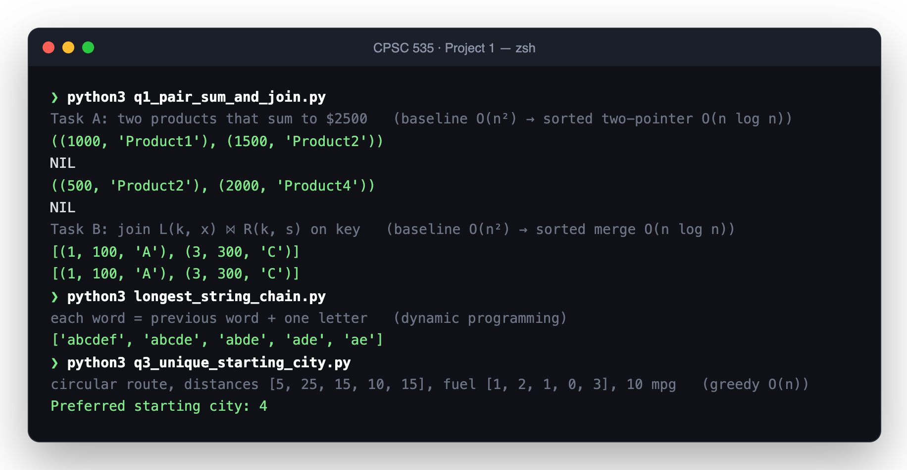

<div align="center">

# Advanced Algorithms · Project 1

**Three real-world puzzles (shipping, database joins and road trips), each solved twice: once the obvious way, then the fast way.**




</div>

---

## The problems

### 🛒 Shipping two items (Q1 · Task A)
*A customer has a $2,500 gift card. Which two products use it up exactly?*
- **Baseline:** check every pair. O(n²).
- **Improved:** sort by price, then walk two pointers inward from both ends. **O(n log n)**.

### 🗂️ Joining two databases (Q1 · Task B)
*Table L holds `(key, amount)` and table R holds `(key, name)`. Produce `(key, amount, name)` for every shared key.*
- **Baseline:** nested loops. O(n²).
- **Improved:** sort both tables by key and merge them like merge sort. **O(n log n)**. This is the idea behind a database *sort-merge join*.

### 🔗 Longest string chain
*Given a word list, find the longest chain where each word is the previous one plus a single letter (`ae → ade → abde → abcde → abcdef`).*
- **Dynamic programming:** process words shortest-first. For each word, try deleting one character at a time to find its best predecessor, and extend that chain.

### ⛽ Unique starting city (Q3)
*Cities sit on a circular road, each with a gas station. Starting with an empty tank, which city lets you drive the whole loop and get back home?*
- **Greedy single pass, O(n):** track the total fuel balance and the current tank. Whenever the tank goes negative, no city up to here can be the start, so reset at the next city. A brute-force check of the sample confirms city 4 is the only valid start.

## Run it

```sh
python3 q1_pair_sum_and_join.py
python3 longest_string_chain.py
python3 q3_unique_starting_city.py
```

Each script runs its examples and prints the answers shown above. Pure Python, no dependencies.

## Team

**Parastoo Toosi · Deepthimayi Pesala · Roszhan Raj Meenakshi Sundhresan**
CPSC 535 Advanced Algorithms, California State University, Fullerton, Fall 2024.
